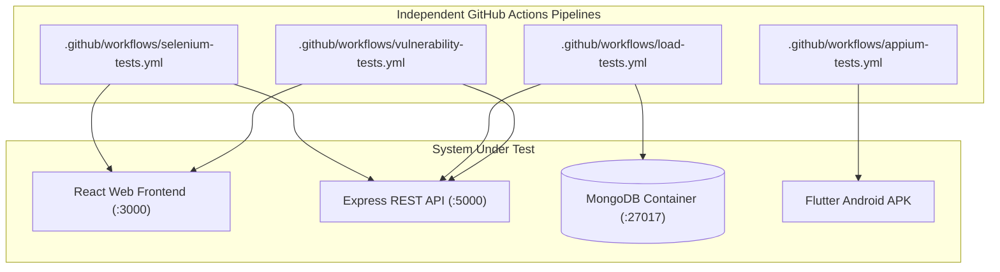

# Comprehensive Test Matrix - Smart Travel Planner

## 1. Overview
The Smart Travel Planner project features **1,200 total automated test definitions** evenly balanced across four testing domains:

| Suite | Category Count | Test Count | Technology | Target Component |
|---|---|---|---|---|
| **Selenium** | 10 Categories | **300** (`SEL-001` - `SEL-300`) | Python, Selenium, pytest | React 19 Web Single Page App |
| **Appium** | 10 Categories | **300** (`APP-001` - `APP-300`) | Python, Appium 2, UiAutomator2 | Flutter Mobile Android App |
| **k6 Load** | 9 Categories | **300** (`LOAD-001` - `LOAD-300`) | Grafana k6, JavaScript | Node.js Express API & MongoDB |
| **Security** | 12 Categories | **300** (`SEC-001` - `SEC-300`) | Python, pytest, Semgrep, npm audit | Full-stack application & repos |
| **TOTAL** | **41 Categories** | **1,200** | Multi-engine QA Automation | Complete Smart Travel Planner |

---

## 2. Independent GitHub Actions Workflows
All four automated test suites run completely independently in GitHub Actions:

## 3. Execution Characteristics & Optimization Matrix

| Feature | Selenium Suite | Appium Suite | k6 Load Suite | Security Suite |
|---|---|---|---|---|
| **Parallel Shards** | 4 parallel shards | Sequential / single runner | Concurrency via VUs | Parallel test discovery |
| **Runner Environment** | `ubuntu-latest` | `ubuntu-latest` (KVM enabled) | `ubuntu-latest` | `ubuntu-latest` |
| **Execution Trigger** | `push`, `pull_request`, `workflow_dispatch` | `push`, `pull_request`, `workflow_dispatch` | `push`, `pull_request`, `workflow_dispatch` | `push`, `pull_request`, `workflow_dispatch` |
| **Artifact Name** | `selenium-test-results` | `appium-test-results` | `k6-test-results` | `security-test-results` |
| **Step Summary** | Markdown table + counts | Markdown table + counts | Markdown table + thresholds | Markdown table + severity |
| **Retries** | 1 retry on flake | 1 retry on flake | 0 (no retry) | 0 (no retry) |
